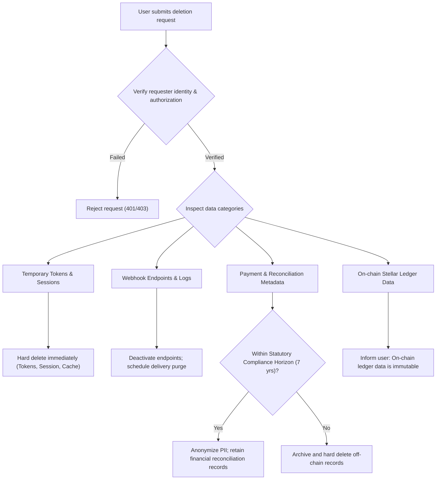

# SorobanPay — Data Retention and Deletion Policy

This policy governs the retention, archiving, and deletion of application records across the SorobanPay backend, relational database, caching layers, and external integrations.

---

## 1. Overview and Scope

SorobanPay processes both off-chain application metadata and on-chain smart contract transactions. This document specifies:
- The data categories collected and managed by SorobanPay.
- Retention rules, retention windows, and designated retention owners for each category.
- Deletion paths and workflows for user requests (GDPR Art. 17 / CCPA Right to be Forgotten).
- Legal exceptions, statutory requirements, and their effect on financial reconciliation and audit compliance.

> [!IMPORTANT]
> **Immutability of On-Chain Blockchain Data**
> Stellar blockchain ledgers and Soroban smart contract persistent storage are cryptographically anchored, publicly visible, and immutable. No operator, administrator, or platform software can alter, rewrite, or delete historical on-chain transactions, events, or state. SorobanPay policies and deletion workflows apply strictly to off-chain application systems, databases, logs, and caches.

---

## 2. Data Categories, Retention Rules, and Owners

| Category | Typical Records / Entities | Retention Period | Retention Owner | Deletion / Pruning Path |
| :--- | :--- | :--- | :--- | :--- |
| **Payment Metadata** | `Payment`, `Subscription` (mirrored off-chain state), amounts, billing intervals, payment nonces | **7 years** from transaction execution (statutory tax & financial reporting) | **Finance & Compliance Lead** | Soft-delete / PII redaction after active subscription termination; automated archive purge after 7 years. Cryptographic hashes retained for reconciliation. |
| **Webhook Attempts** | `WebhookDelivery`, delivery status, HTTP status codes, payloads, timestamps, retry counts | **30 days** for successful deliveries; **90 days** for failed/quarantined attempts | **Platform Operations (SRE / DevOps)** | Rolling automated prune via scheduled background worker; hard deletion of delivery payload records older than retention window. |
| **Audit Records** | `AuditLog`, `CancellationAudit`, admin state change records, security logs | Configurable via `AUDIT_RETENTION_YEARS` (**default: 7 years**) | **Security & Compliance Officer** | Append-only store. Automated batch prune via `pruneExpiredAuditRecords` only after statutory retention elapses. Subject to legal holds. |
| **Temporary Tokens** | JWT refresh tokens, email unsubscribe tokens (`unsubToken`), idempotency keys, OAuth states | **15 minutes** (access), **7 days** (refresh), **24 hours** (idempotency), or upon revocation | **Backend & Identity Team** | Expired automatically via TTL eviction (Redis) or batch purge upon user logout/preference change. |
| **Immutable On-Chain Data** | Ledger sequence numbers, transaction hashes, smart contract storage, emitted contract events | **Permanent / Protocol-managed** (network lifecycle and ledger rent TTL) | **Decentralized Network (Validators)** | **Non-deletable.** Any request to delete on-chain data is rejected with a documented technical impossibility notice. |

---

## 3. Detailed Data Categories and Deletion Paths

### 3.1 Payment Metadata
- **Description:** Off-chain database tables (`Payment`, `Subscription`, `Event`) mirroring on-chain activity to power merchant dashboards, customer billing history, and automated recurring billing schedules.
- **Retention Rule:** Retained for 7 years following the calendar year in which the transaction occurred to comply with international statutory tax, commercial law, and AML recordkeeping requirements.
- **Deletion Path:**
  1. *During statutory period:* When a subscriber or merchant requests deletion, PII (names, emails, IP addresses, customer references) is cryptographically scrubbed or pseudonymized (`DELETED_USER_<UUID>`).
  2. *Reconciliation preservation:* Financial figures (stroop amounts, token contracts, payment nonces, transaction hashes) remain in the database with anonymized party references so balance reconciliation remains intact.
  3. *Post-statutory period:* Records older than 7 years are safely exported to cold encrypted archives and deleted from active database storage.

### 3.2 Webhook Attempts and Deliveries
- **Description:** Records in `WebhookDelivery` and `WebhookEndpoint` tracking delivery notifications sent to merchant endpoint URLs, including HTTP response codes, request headers, error messages, and payload snippets.
- **Retention Rule:**
  - Successful deliveries (`status = 'delivered'`): 30 days.
  - Failed or pending retry deliveries (`status = 'failed'`): 90 days for operational debugging.
- **Deletion Path:**
  - Scheduled background maintenance job queries records older than cutoff:
    ```sql
    DELETE FROM "WebhookDelivery" WHERE "createdAt" < NOW() - INTERVAL '30 days' AND "status" = 'delivered';
    DELETE FROM "WebhookDelivery" WHERE "createdAt" < NOW() - INTERVAL '90 days';
    ```
  - When a merchant deletes a `WebhookEndpoint`, delivery logs are disassociated immediately and hard-deleted after 14 days.

### 3.3 Audit and Compliance Records
- **Description:** Append-only cancellation audits (`CancellationAudit`) and security-relevant administrative actions (`AuditLog`).
- **Retention Rule:** 7 years by default, configurable via the `AUDIT_RETENTION_YEARS` environment variable.
- **Exceptions (Legal Hold):** If an ongoing dispute, chargeback arbitration, litigation, or regulatory inquiry occurs, affected audit records are marked with `legalHold = true` which suspends any automated pruning.
- **Deletion Path:**
  - The `cancellationAuditService.pruneExpiredAuditRecords()` function executes on a periodic schedule, deleting records where `cancelledAt < NOW() - AUDIT_RETENTION_YEARS` and `legalHold = false`.

### 3.4 Temporary Tokens and Transient Session State
- **Description:** Cryptographic secrets and short-lived credentials, including session JWTs, refresh tokens, idempotency locks, and email preferences.
- **Retention Rule:**
  - Idempotency execution markers: 24 hours.
  - Refresh tokens: 7 days.
  - Unsubscribe tokens: Until notification preference record is updated or subscriber account is closed.
- **Deletion Path:**
  - In-memory and Redis caches use automatic key expiration (`EXPIRE key 86400`).
  - Revoked refresh tokens are removed immediately from storage upon user logout or password rotation.

---

## 4. Handling User Deletion Requests (GDPR / CCPA)

When an authorized user or merchant submits a "Right to be Forgotten" or account deletion request:



### 4.1 Step-by-Step Deletion Workflow
1. **Authentication and Scope Verification:**
   The requester's identity (wallet signature or OAuth claim) is verified. Requests cannot delete records belonging to other tenants.
2. **Identification of Exemptions:**
   The Compliance Officer checks if the records are subject to statutory financial reporting, open disputes, or active legal holds.
3. **Execution of Deletion:**
   - **Immediately Deleted:** Notification preferences, contact emails, active session tokens, webhook secrets.
   - **Anonymized:** Historical payments and subscription mirror records have identifying names, IPs, and email handles replaced with cryptographically random hashes.
   - **Preserved:** Transaction hashes (`txHash`), transfer amounts, and ledger timestamps are kept to maintain double-entry accounting integrity with the Stellar ledger.
4. **Resolution Notice:**
   The user receives a completion report detailing:
   - What data was deleted (credentials, webhook settings, notification preferences).
   - What data was pseudonymized for statutory compliance (payment audit trail).
   - Clear confirmation that on-chain ledger history cannot be altered or removed.

---

## 5. Effect on Reconciliation and Compliance

- **Financial Reconciliation Integrity:**
  Reconciliation relies on comparing ledger events with off-chain `Payment` records. Purging payment amounts or transaction hashes would cause irreconcilable balance discrepancies and audit failures. By scrubbing PII while retaining ledger hashes and amounts, financial reconciliation remains 100% mathematically verifiable without retaining personal data.
- **Compliance Reporting:**
  Tax authorities and financial regulators require verifiable records of payment execution and cancellations for up to 7 years. Preserving pseudonymized records fulfills regulatory obligations under GDPR Article 17(3)(b) (compliance with a legal obligation) and Article 17(3)(e) (establishment, exercise or defense of legal claims).

---

## 6. Operational Configuration

The following environment variables govern retention behavior across SorobanPay services:

| Variable | Default Value | Description |
| :--- | :--- | :--- |
| `AUDIT_RETENTION_YEARS` | `7` | Retention window (in years) for audit and cancellation logs. |
| `WEBHOOK_DELIVERY_RETENTION_DAYS` | `30` | Retention window (in days) for delivered webhook logs. |
| `WEBHOOK_FAILED_RETENTION_DAYS` | `90` | Retention window (in days) for failed webhook delivery logs. |
| `IDEMPOTENCY_TTL_SECONDS` | `86400` | Expiration TTL (in seconds) for payment execution idempotency cache. |
| `ENABLE_AUTOMATED_DATA_PRUNING` | `true` | Enables background worker cron schedules for automated pruning. |
