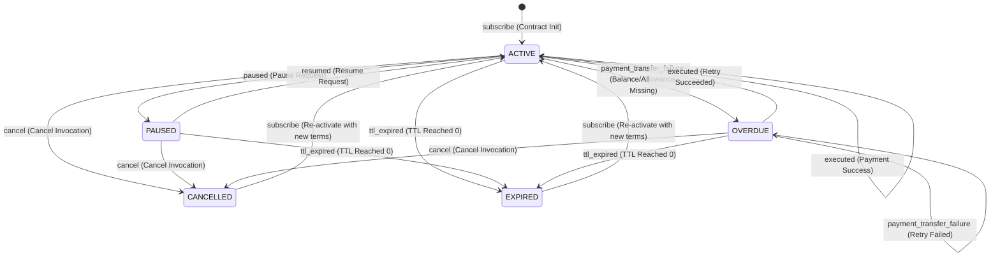

# Operator Glossary: Payment, Indexer, and Subscription State Transitions

This document provides a canonical cross-system mapping of subscription and payment lifecycle states across the **Smart Contract**, **Backend State Machine**, **Off-Chain Indexer**, **Webhook Payloads**, and the **Merchant Portal UI**.

---

## 1. System-Wide State Mapping

Different components use specific terminology to optimize for on-chain storage efficiency, database normalization, or merchant clarity. Every documented state maps directly to an implementation constant or event in code.

| Canonical State | Contract Equivalent / Event | Backend Model (`Subscription.status`) | Webhook Payload (`WebhookEventType`) | Merchant UI Label | Terminal? | Definition & Operational Meaning |
|---|---|---|---|---|:---:|---|
| **ACTIVE** | `subscribe`, `executed`, `payment_transfer_success` | `ACTIVE` | `payment.executed` | **Active** | No | Subscription is valid and in good standing. Scheduled charges will execute on or after `next_payment`. |
| **PAUSED** | `paused` event / storage flag | `PAUSED` | *(None)* | **Paused** | No | Billing is temporarily frozen at user/merchant request. Ledger TTL must still be refreshed. |
| **OVERDUE** | `payment_transfer_failure` | `OVERDUE` | `payment.failed` | **Past Due** | No | Payment failed (insufficient subscriber balance or allowance). In automatic retry grace window. |
| **CANCELLED** | `cancel` event / storage entry deleted | `CANCELLED` | `subscription.cancelled` | **Cancelled** | **Yes** | Subscription terminated by subscriber or merchant. On-chain entry deleted. No further payments can execute. |
| **EXPIRED** | `ttl_expired` / ledger archival | `EXPIRED` | *(None)* | **Expired** | **Yes** | Storage TTL expired or maximum subscription horizon elapsed. Requires a fresh `subscribe` call to restart. |

---

## 2. State Transition Diagram



---

## 3. Exceptional Outcomes & Troubleshooting Table

When payment processing diverges from the happy path, operators reference this table to identify causes, system impacts, and corrective operational actions:

| Trigger Event | Initial State | Result State | Root Cause | System Impact | Operator Troubleshooting & Recovery |
|---|---|---|---|---|---|
| `payment_transfer_failure` | `ACTIVE` | `OVERDUE` | Subscriber token balance < required amount, or SEP-41 allowance revoked/depleted. | Immediate transfer rejected. Dispatches `payment.failed` webhook to merchant. Enqueues payment in retry worker. | Check subscriber balance on Stellar Horizon/Expert. Send automated billing reminder. Grace period defaults to 3 days. |
| `payment_transfer_failure` | `OVERDUE` | `OVERDUE` | Retry worker executed payment but balance/allowance is still missing. | Exponential backoff delay increments (`1s`, `5s`, `15s`, `60s`, `300s`). Max attempts = 5. | If max retries exhausted without success, notify merchant account team for manual customer outreach. |
| `ttl_expired` | Any non-terminal | `EXPIRED` | Smart contract persistent storage entry was not extended and was archived by the Soroban network. | Contract call `get_subscription` fails with missing entry. Indexer flags subscription as archived. | Run `restoreFootprint` if restoration is permitted, or direct subscriber to re-subscribe via frontend onboarding flow. |
| `cancel` | `OVERDUE` | `CANCELLED` | Subscriber or merchant cancels while past-due. | Evicts pending payment retry jobs from queue. Emits `subscription.cancelled` webhook. | Reconcile outstanding uncollected service usage in merchant accounting system. Cease service provisioning. |
| `contract_migrated` | Any | Preserved | Admin executed contract schema migration (`migrate(admin)`). | Storage schema updated to current schema version without dropping active subscriptions. | Verify schema version emitted in `contract_migrated` event matches backend parser version expectation. |

---

## 4. Intentionally Different Display Labels

In the merchant portal and subscriber receipts, certain internal state names are translated to ensure clarity for non-technical users:

- **`OVERDUE` → "Past Due"**: Merchants recognize "Past Due" as an industry-standard accounting term representing a grace-period payment failure, avoiding alarm while retries are ongoing.
- **`CANCELLED` → "Cancelled"**: Displayed with a neutral gray badge indicating terminal closure without fault.
- **`EXPIRED` → "Expired"**: Emphasizes that the contract storage TTL or subscription term ended naturally, requiring re-authorization.

---

## 5. Cross-System Event Parity Verification

To verify that off-chain indexer records match on-chain truth, operators run the diagnostic reconciliation query:

```sql
-- Query subscriptions where backend state does not match recent event ledger logs
SELECT s.id, s.subscriber, s.merchant, s.status, s.updated_at
FROM "Subscription" s
WHERE s.status = 'ACTIVE'
  AND s.updated_at < NOW() - INTERVAL '14 days'
ORDER BY s.updated_at ASC;
```

Related references:
- State Machine Implementation: `backend/src/lib/subscriptionStateMachine.ts`
- Event Schema Reference: [docs/event-schema.md](./event-schema.md)
- Webhook Delivery Integration: [docs/webhook-integration.md](./webhook-integration.md)
- Storage TTL Operational Runbook: [docs/operations.md](./operations.md)
